<h1> hey, I'm Akshay 👋</h1>

Student &amp; builder from Kerala. Usually somewhere between a learning problem, a care problem, and one stubborn ESP32.

<h3><a href="https://akshayabraham.vercel.app/?utm_source=github&amp;utm_medium=profile_readme">Step inside the website ↗</a></h3>

<a href="https://akshayabraham.vercel.app/projects">Projects</a> · <a href="https://akshayabraham.vercel.app/skills">Skills</a> · <a href="https://akshayabraham.vercel.app/about">Journey</a>

---

### The toolbox

  

| | In the mix |
| :--- | :--- |
| **Languages** | TypeScript · Python · Kotlin · C · JavaScript |
| **Web & apps** | Next.js · React · Tailwind CSS · Node.js · FastAPI · Android |
| **AI & data** | LangChain · OpenCV · MediaPipe · Supabase · PostgreSQL · SQLite |
| **Hardware & setup** | ESP32 · Arduino · Docker · Fedora KDE |

The full tool-by-project map is [on my skills page ↗](https://akshayabraham.vercel.app/skills).

### On my desk right now

| 📚 **Lyra** | 🧠 **MNEMO & Mitra** |
| :--- | :--- |
| Guided learning that keeps students thinking. | Memory care tools built with Chris V Jacob. |

The longer versions are [on my projects page ↗](https://akshayabraham.vercel.app/projects).

### Side quests

[📱 M57](https://github.com/akshay-abraham/m57) · [👁️ Driver Guard](https://github.com/akshay-abraham/driver_guard) · [💧 NEPHRA](https://github.com/akshay-abraham/NEPHRA) · [🪐 My cool website (yes, again)](https://akshayabraham.vercel.app/)

---

<strong>Have a question, an idea, or just want to say hi?</strong> 
<a href="mailto:akshaykroobenabraham@gmail.com">Email me</a> · <a href="https://www.linkedin.com/in/akshayabraham37/">LinkedIn</a> · <a href="https://akshayabraham.vercel.app/">Website</a>

